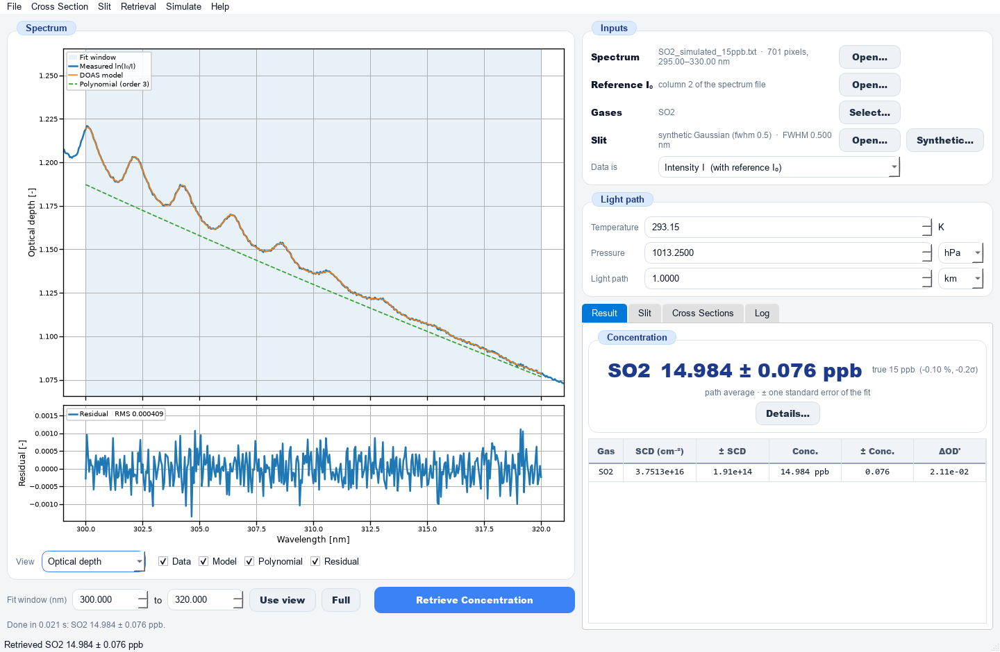
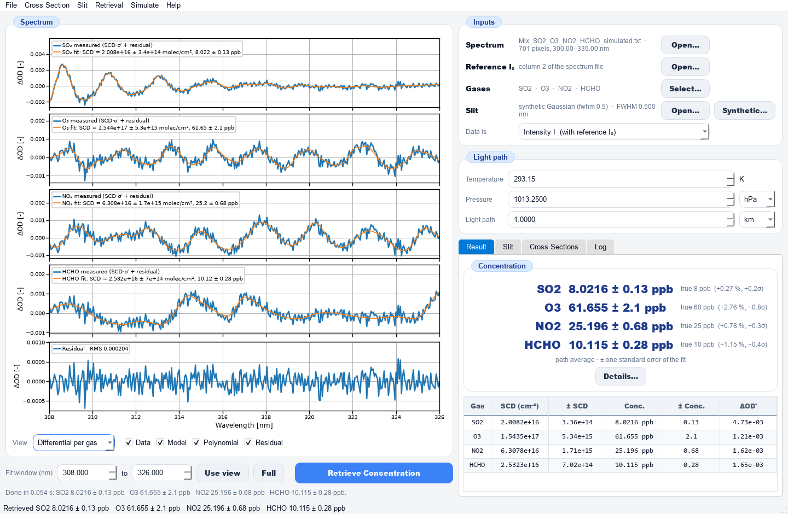
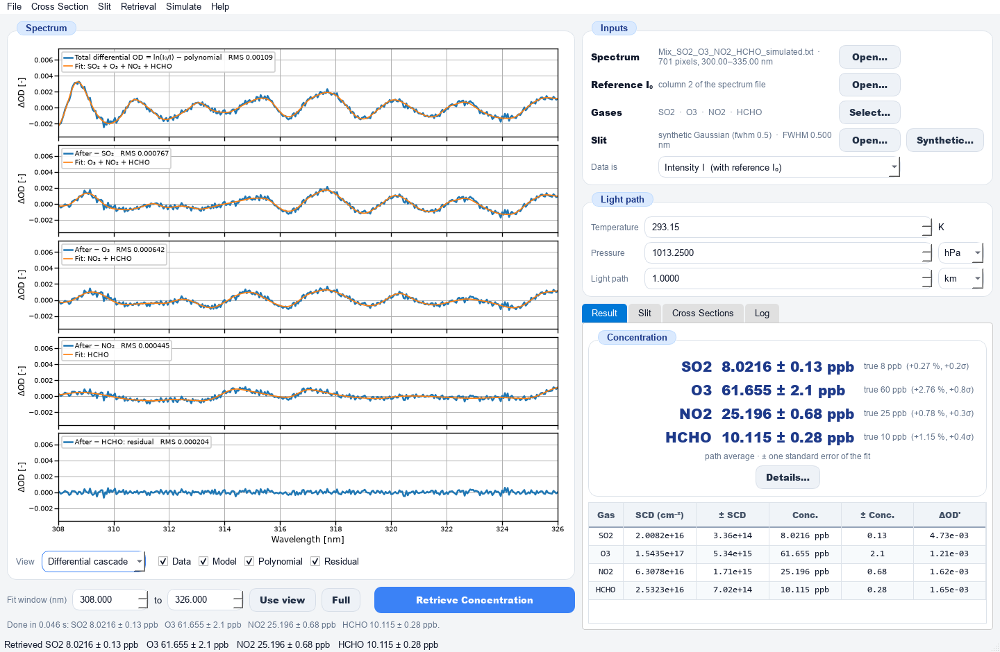
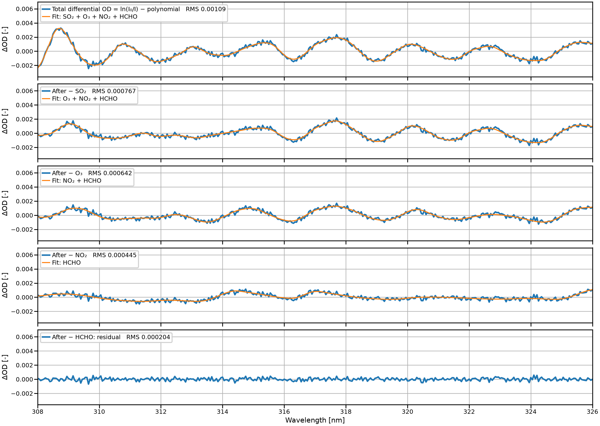

# UV-DOAS Concentration

Retrieves the slant column density (SCD) and the path-averaged concentration
(ppb) of trace gases from a UV spectrum by **Differential Optical Absorption
Spectroscopy**. Absorption cross sections convolved with the spectrometer's
slit function are fitted, together with a polynomial for the broadband
extinction, to the optical depth ln(I₀/I) by **linear** least squares.





## How to cite

This software was developed inspired by:

> Trisna, B. A., et al.: Total Column Amount Retrieval of SO2 using a zenith-sky DOAS instrument, Conference: The 3rd Korea Geoscience Union, 2022, Gangwon-do

**If you use this code for a publication, you must cite this paper.**

---

## The model

```
ln(I0(λ)/I(λ)) = Σ_i SCD_i · σ_eff,i(λ + shift) + P(λ) + residual
σ_eff,i        = σ_high-res,i ⊛ slit                       (slit.py, doas.Reference)
P(λ)           = Legendre polynomial in the window         (broadband: Rayleigh, Mie, lamp, throughput)
n_i            = SCD_i / L                                 molecule/cm³, path average
x_i            = n_i / N_air,   N_air = P / (k_B T)        mixing ratio (ppb)
```

For a fixed shift the model is linear in the SCDs and the polynomial
coefficients, so one least-squares solve gives them all with their covariance.
The shift (and optionally a squeeze) is the only non-linear parameter: an
outer search, each step a linear solve, and the final errors come from the
full Jacobian. Fitting σ together with P is the same as fitting the
differential cross section σ′ (σ minus its own polynomial), which is what the
*Differential per gas* view shows.

## Installation

```
python -m venv .venv
.venv\Scripts\python -m pip install -r requirements.txt
```

## Running

```
python DOAS_GUI.py                          # opens and retrieves the single-gas example
python DOAS_GUI.py spectrum.txt             # opens a spectrum
python DOAS_GUI.py --no-example             # starts empty
python DOAS_GUI.py --selftest               # both examples, no window
python DOAS_GUI.py --selftest --save --montecarlo
                                            # + reports, curves and publication figures (PNG, PDF) in Results/, 50-seed Monte Carlo
python simulate_spectrum.py                 # rebuilds the two example spectra in Input/
python cross_section.py                     # re-imports the laboratory set, rewrites the synthetic one
python build_xs_database.py                 # rebuilds the cross-section database from Input/modataXs
```

## Using the GUI

**Left:** the spectrum plot with four views, *Optical depth* (measured
ln(I₀/I), DOAS model, polynomial, residual), *Differential cascade* (the
total differential OD = ln(I₀/I) − polynomial, then one gas subtracted per
panel until only the residual is left; all panels share the y scale and show
the RMS of what remains), *Differential per gas* (one
panel per gas: measured differential OD vs the fitted SCD·σ′, as in
QDOAS/WinDOAS) and *Intensity* (I₀ and I). Below it are the fit window, *Use
view*, *Full* and **Retrieve Concentration**.

**Right:**
- **Inputs**: the spectrum, the reference I₀, the gases (cross sections) and the slit (file or *Synthetic…*).
- **Light path**: T, P and the **total** light path (twice the telescope–reflector distance for a retro-reflector).
- **Tabs**: *Result* (concentration per gas, SCD table, *Details…* with number density, detection limit, correlations, shift, polynomial, RMS and warnings), *Slit*, *Cross Sections* (σ high-res vs σ ⊛ slit, or σ′), *Log*.

**Menus:** *File* (open spectrum / I₀, save result, export curves, save
plot as a publication figure), *Cross Section* (select gases from the
recommended set and the database, with search; add a file; write the synthetic set),
*Slit* (load a file or build a synthetic one), *Retrieval* (retrieve,
settings: polynomial order, shift/squeeze, convolution grid, unit),
*Simulate* (synthetic spectrum), *Help* (examples, method).

### Input file formats

| File | Columns |
|---|---|
| Spectrum | `λ(nm)  I0  I` (three columns), or `λ  I` with I₀ from *Open Reference I₀*, or `λ  ln(I0/I)` (set *Data is* to optical depth) |
| Cross section | `λ(nm)  σ(cm²/molecule)` or `ν(cm⁻¹)  σ`; comment lines `#`, `;`, `!`, `%` |
| Slit | `offset(nm)  value`, or absolute wavelength (e.g. a Hg 302.15 nm line) – it is centred at its peak |

The gas name comes from a `# gas NAME` header line or from the file name up to the first `_`.

### Synthetic slit functions

| Kind | Parameters |
|---|---|
| Gaussian | FWHM |
| Asymmetric Gaussian | FWHM, asymmetry a (right half-width ·(1+a), left ·(1−a)) |
| Super-Gaussian (flat top) | FWHM, exponent k (k = 2 is Gaussian) |
| Boxcar ⊗ Gaussian | slit-image width, blur FWHM |
| Voigt | Gauss FWHM, Lorentz FWHM (far wings) |

## Cross sections

### Where real cross sections come from

There is no single database with a download API (unlike HITRAN for the IR):

| Source | What | Access |
|---|---|---|
| MPI-Mainz UV/VIS Spectral Atlas (uv-vis-spectral-atlas-mainz.org) | the largest compilation, every gas | web, one file at a time |
| IUP Bremen (Voigt, Serdyuchenko/Gorshelev, Bogumil) | O3, NO2 and others, temperature series | web download |
| BIRA-IASB (Vandaele et al.) | NO2, SO2 FTS data | web download |
| HITRAN cross-section section | mostly IR, some UV | HITRANonline |

### Laboratory cross sections (`Input/modataXs`)

The program uses the laboratory collection in `Input/modataXs`.
`cross_section.import_lab_set()` (menu *Cross Section → Import Laboratory
Cross Sections*, also run at start-up) writes the chosen data sets as clean
two-column files on the **air** wavelength scale to `Input/CrossSections`:

| File | Source in `modataXs` | Reference | Resolution | Wavelength scale |
|---|---|---|---|---|
| `SO2_Vandaele_295K.xs` | `so2vandaele` | Vandaele et al., JGR 1994 | FTS, step 0.0064 nm | air (matches Brassington and the MPI compilation to <0.01 nm) |
| `O3_Bremen_293K.xs` | `o3_293h.dat` | Voigt et al., JPPA 2001 | FTS, 5 cm⁻¹ | vacuum in the file → converted to air (Edlén) |
| `NO2_Bremen_293K.xs` | `bremen/no2_293h.zip` | Voigt et al., JPPA 2002 | FTS, 0.5–1 cm⁻¹ | vacuum → air; then matches Mérienne 1995 (Reims) to 0.02 nm |
| `HCHO_Cantrell_296K.xs` | `hchocal.dat` | Cantrell et al., JPC 1990 | FTS, step 0.0056 nm | as given; sits +0.03…+0.07 nm from Meller 2000 / Bass – check |

The wavelength scale of each set was checked by cross-correlating it with
other data sets of the same gas in the collection. `no2reims.dat` was not
chosen because its 293 K data start at 336.6 nm and miss the SO2 windows.
The full Meller & Moortgat (2000) HCHO data set (298 K and 223 K) is in
`hchomoor.dat` and in the database below; `HCHOMOO2.DAT` / `HCHO2000.DAT`
hold only its 224–232 nm part.

`load_xs` reads the old formats of the collection as they are: OMA/MPI files
with Fortran-format headers, the Bremen "nm, cm⁻¹, σ, error" columns,
multi-temperature tables (the first temperature is taken) and `.zip` archives.
Any of them can be added directly with *Add Cross-section File*. A header
that says "vacuum" is converted to air.

**The choice of data set matters.** The same simulated spectrum, retrieved
with a different laboratory data set of the same gas (noise-free):

| Simulated with | Retrieved with | Result |
|---|---|---|
| SO2 Vandaele | McGee 295 K (`so2295.dat`) | +0.1 % |
| SO2 Vandaele | MPI compilation (`so2.dat`) | −3.6 % |
| SO2 Vandaele | Brassington (`so2bra.dat`) | −8.1 % |
| NO2 Bremen 293 K | Mérienne (`no2reims.dat`) | −6.9 % |
| HCHO Cantrell | Meller, MPI (`hchompi.dat`) | −9.8 % |

That is the systematic uncertainty a real measurement takes from its cross
sections, on top of the fit error.

### The cross-section database (all of `Input/modataXs`)

`python build_xs_database.py` turns the **whole** collection into a database
of clean cross-section files, one folder per species, in `Input/CrossSections`:

```
Input/CrossSections/
    SO2_Vandaele_295K.xs ...           the recommended set (above) and the synthetic set
    <gas>/<gas>_<T>K_<source file>.xs  the database: 247 data sets of 64 species
    catalog.csv, catalog.json          one row per data set
    excluded.csv                       every file of modataXs not used, and why
```

Every file of the collection (382 files plus the members of its zip archives)
is listed in `FILES` in `build_xs_database.py` with what it holds: gas,
temperature, reference, unit scale, wavelength axis (nm or cm⁻¹), wavelength
scale (air/vacuum) and whether it is an absolute or a differential cross
section. The metadata come from the files' own headers and from the
collection's index `modata.txt`; where a header is missing, the entry says so.

| Group | Species (data sets) | Temperatures (K) |
|---|---|---|
| Atmospheric DOAS species | **SO2** (11) · 189–328 nm | 210, 213, 293, 295, ? |
|  | **O3** (33) · 176–851 nm | 202, 203, 218, 220, 221, 223, 228, 241, 243, 246, 250, 273, 280, 293, 295, 298, ? |
|  | **NO2** (47) · 189–833 nm | 200, 213, 217, 220, 221, 223, 225, 230, 238, 240, 241, 243, 246, 253, 260, 263, 273, 280, 293, 294, 295, 296, 298, 298.2, ? |
|  | **NO3** (4) · 400–704 nm | 230, 298 |
|  | **HCHO** (6) · 216–386 nm | 223, 284.7, 295, 296.16, 297, 298 |
|  | **HONO** (2) · 292–404 nm | 296, ? |
|  | **BrO** (8) · 301–671 nm | 228, 243, 298 |
|  | **IO** (3) · 341–538 nm | 293, 295, ? |
|  | **OClO** (11) · 242–476 nm | 200, 204, 213, 233, 253, 273, 293, 298, 378 |
|  | **ClO** (2) · 237–317 nm | ? |
|  | **O2** (4) · 183–796 nm | 296, ? |
|  | **O4** (2) · 328–666 nm | 283, ? |
|  | **H2O** (2) · 440–680 nm | 273, ? |
| Halogens and halogen compounds | **Br2** (5) · 300–750 nm | 298, 298.15, ? |
|  | **Cl2** (21) · 176–643 nm | 195, 291, 293, 298, 301, 441, 456, 554, 593, 699, 737, 849, 853, 982, 1038, ? |
|  | **BrCl** (2) · 200–600 nm | 295, ? |
|  | **Cl2O** (1) · 237–319 nm | ? |
|  | **Cl2O2** (1) · 212–427 nm | ? |
|  | **CH2Br2** (6) · 174–300 nm | 210, 230, 250, 270, 295, ? |
|  | **CHBr3** (4) · 170–362 nm | ? |
|  | **CH2Cl2** (1) · 160–255 nm | ? |
|  | **CH3Cl** (6) · 174–220 nm | 210, 230, 250, 270, 295 |
|  | **CHCl3** (1) · 174–240 nm | 295 |
|  | **CH2I2** (1) · 250–406 nm | 294 |
|  | **CH3I** (2) · 197–324 nm | 296.16 |
|  | **COCl2** (2) · 185–315 nm | ? |
|  | **COF2** (6) · 185–232 nm | 295, 296, ? |
|  | **HCOF** (1) · 194–267 nm | ? |
|  | **CF3COCl** (1) · 198–335 nm | 296 |
|  | **CF3COF** (1) · 198–283 nm | 296 |
| Other inorganic | **CS2** (3) · 265–380 nm | ? |
| Oxygenated VOCs | **Acetaldehyde** (2) · 198–362 nm | ? |
|  | **Acetone** (1) · 197–365 nm | ? |
|  | **Acetol** (1) · 208–333 nm | 296 |
|  | **MEK** (1) · 197–365 nm | ? |
|  | **MVK** (2) · 240–398 nm | 300, ? |
|  | **Methacrolein** (2) · 237–391 nm | ? |
|  | **Methanol** (1) · 162–196 nm | 295.2 |
|  | **Methylglyoxal** (3) · 218–494 nm | 296, ? |
|  | **PAN** (2) · 230–450 nm | ? |
| Aromatic hydrocarbons | **1,2,4-Trimethylbenzene** (1) · 231–286 nm | ? |
|  | **1,3,5-Trimethylbenzene** (1) · 246–286 nm | ? |
|  | **2,3-Dimethylphenol** (1) · 248–288 nm | ? |
|  | **2,4,6-Trimethylphenol** (1) · 261–300 nm | ? |
|  | **2,4-Dimethylphenol** (1) · 256–295 nm | ? |
|  | **2,5-Dimethylphenol** (1) · 258–297 nm | ? |
|  | **2,6-Dimethylphenol** (1) · 248–288 nm | ? |
|  | **3,4-Dimethylphenol** (1) · 241–295 nm | ? |
|  | **3,5-Dimethylphenol** (1) · 250–290 nm | ? |
|  | **Benzaldehyde** (2) · 254–295 nm | 293.15, ? |
|  | **Benzene** (2) · 219–278 nm | 293.65, ? |
|  | **Ethylbenzene** (1) · 238–278 nm | ? |
|  | **m-Cresol** (1) · 251–291 nm | ? |
|  | **m-Toluidine** (1) · 266–305 nm | ? |
|  | **m-Xylene** (2) · 239–283 nm | 293.65, ? |
|  | **o-Cresol** (1) · 251–291 nm | ? |
|  | **o-Toluidine** (1) · 266–305 nm | ? |
|  | **o-Xylene** (2) · 239–281 nm | 294.15, ? |
|  | **p-Cresol** (2) · 251–293 nm | 293.15, ? |
|  | **p-Toluidine** (1) · 256–295 nm | ? |
|  | **p-Xylene** (2) · 239–283 nm | 293.15, ? |
|  | **Phenol** (2) · 244–288 nm | 293.65, ? |
|  | **Styrene** (1) · 225–290 nm | ? |
|  | **Toluene** (2) · 238–278 nm | 293.15, ? |

`?` = temperature not stated in the file or the index.

**Every output file** has two columns (air wavelength in nm, σ in
cm²/molecule; for O₄ cm⁵/molecule²) and a header that records the gas, the
temperature, the reference, the source file, the kind (absolute or
differential), the unit, the wavelength scale and every conversion applied:

```
# gas HCHO
# T 223 K
# reference: R. Meller, G.K. Moortgat, J. Geophys. Res. 105, 7089 (2000)
# source: Input/modataXs/hchomoor.dat
# kind: absolute
# unit: cm2/molecule
# wavelength scale: as given in the source (assumed air)
```

**What the builder does to the data**

| Step | Example |
|---|---|
| Unit scale factors stated in the header | Frost NO₂ ×10⁻¹⁸, Frost OClO ×10⁻¹⁷, NOAA NO₂ ×10⁻¹⁹, Cacciani O₃ ×10⁻²⁰, Graham O₃ ×10⁻²², Anderson O₃ ×10⁻²³, Simon/Gillotay tables ×10⁻²¹, Harder H₂O ×10⁻²⁵, Newnham O₄ ×10⁻⁴⁶ |
| Wavenumber → wavelength | Bremen OClO, Yoshino O₂, the 1997 NO₂ pair |
| Vacuum → air wavelength (Edlén) | IUP Bremen FTS (O₃, NO₂, OClO), GOME `.dat`, Newnham O₄ |
| One file per temperature | `no2jones.dat` (7 T), `o3brion.dat` (5 T), `oclo-iup.dat` (5 T), `no2reims.dat` (3 T), `ch3clsim.txt`, `dbmgil.txt` (5 T each); "no data" markers 0 / 9999 removed |
| Several data sets in one file split | `hchomoor.dat` is an e-mail with three attachments: Meller & Moortgat HCHO at **298 K** and **223 K**, and the temperature gradient dσ/dT (not a cross section, left out) |
| Parts of one data set joined | Frost NO₂ `no2_05a` + `no2_05b`, Frost OClO parts 1–3 |
| Special layouts | NOAA single-column files (start + step in the header), Erle H₂O, Excel sheets (`aromate/xls`, two grating settings joined) |
| Duplicates kept once | 263 copies (in `refmainz.zip`, `orgref.zip`, the Bremen archives, renamed copies) recognised by content; the original with its header is kept |
| Values that cannot be a cross section removed | a header line read as data (> 10⁻¹⁴ cm²) |

**What is not in the database** (`excluded.csv`, with the reason for each
file): emission-line lists and Hg lamp spectra, solar and lunar spectra,
filter curves, albedo, LOWTRAN radiances, documents and Origin/Excel project
files, OMA spectra without a wavelength axis, and data whose unit cannot be
turned into an absolute cross section with certainty – relative or arbitrary
units (`io.dat`, `obro.dat`, the O₄ relative spectra), plotter millimetres
(`so2war.dat`, `macbir.dat`), molar extinction or absorption coefficients
whose base is not stated (`acnlak.dat`, `hchosny.dat`, `no2bas.org`), and
`hno2jo.dat` (values that fit no power of ten against the other HONO data).

**Quality column.** `catalog.csv` flags, per data set, what is worth a look:
values below −1 % of the peak (more than noise around zero), fewer than 50
points, and an absolute level that differs from the other data sets of the
same gas (median ratio of 1 nm means outside 0.6–1.6). Flags that are worth
knowing:

- **Aromatics, Trost 1994 (`*_hd.dat`) vs the later Heidelberg set
  (`aromate/xls`)**: the levels differ by a factor 2–15 (an offset in the
  1994 files); the narrow structure agrees for the xylenes but not for
  benzene and benzaldehyde. Prefer the `aromate/xls` set.
- **Toluene (`toluene.xls`)**: a third of the values far below zero.
- **Cl₂ at 737–982 K**: a higher level is real (hot bands), not an error.
- Most "negative values" flags of the Bremen FTS data are in the wings
  where the gas hardly absorbs.

In the GUI, *Cross Section → Select Gases* lists the recommended set and the
whole database, with a search box (gas, temperature, author, file …),
"only files covering the fit window", and the reference, source and quality
remark of every file in its tooltip. The same search is in *Simulate →
Synthetic Spectrum*.

### Synthetic cross sections

`*_synthetic_293K.xs` (SO2, O3, NO2, HCHO; *Cross Section → Write Synthetic
Cross Sections*) are analytic band models of the right size. **They are not
real spectra.** Use them only to test the program without any data.

## Worked examples (in `Input/`)

Simulated with the **laboratory** cross sections for a 1 km long-path DOAS
(293.15 K, 1013.25 hPa) with a Gaussian slit of 0.5 nm FWHM, 0.05 nm pixels, a
0.02 nm calibration shift, Rayleigh and Mie extinction (20 km visibility) and
noise. The simulator applies the slit to the **intensity**, as the instrument
does, so the retrieval's σ ⊛ slit approximation is tested too.

| Example | True | Retrieved (seed 1) |
|---|---|---|
| `SO2_simulated_15ppb.txt`, 300–320 nm | SO2 15 ppb | 14.98 ± 0.08 ppb |
| `Mix_SO2_O3_NO2_HCHO_simulated.txt`, 308–326 nm | SO2 8, O3 60, NO2 25, HCHO 10 ppb | 8.02 ± 0.13, 61.7 ± 2.1, 25.2 ± 0.7, 10.1 ± 0.3 ppb |

The multi-gas window ends at 326 nm because the SO2 data stop at 327.7 nm.
The Monte Carlo (`--montecarlo`, 50 noise seeds) shows the retrieval is
unbiased and its error bars are right:

| Gas | Mean of 50 | Bias | Pull std (should be 1) |
|---|---|---|---|
| SO2 (single) | 14.98 | −0.14 % | 1.13 |
| SO2 (multi) | 8.01 | +0.16 % | 0.94 |
| O3 | 60.01 | +0.02 % | 0.88 |
| NO2 | 25.22 | +0.88 % | 1.08 |
| HCHO | 10.02 | +0.18 % | 0.99 |

`Results/example_*` holds the reports, curves and figures of both examples
(see [The differential cascade](#the-differential-cascade) and [Publication figures](#publication-figures)).

## The differential cascade

DOAS identifies a gas by its narrow, *differential* absorption, not by the
total optical depth. The cascade figure shows that separation step by step:
it starts from the **total differential optical depth** (the measured
ln(I₀/I) minus its broadband polynomial) and subtracts the fitted
contribution SCDᵢ·σ′ᵢ of one gas per panel, until only the **residual** is
left.



*Multi-gas example (308–326 nm, laboratory cross sections, 1 km path).
Top: total differential OD with the fit of all four gases; then what remains
after subtracting SO₂, O₃ and NO₂, each with the fit of the gases still in
it; bottom: after subtracting HCHO only the residual is left. All panels
share one y scale, so the size of each gas's contribution and of the
residual can be compared directly; each legend gives the RMS of its panel.*

How it is computed (`doas.cascade_steps`):

```
D(λ)      = ln(I0/I) − P(λ)            the measured OD minus its own Legendre fit of the same order
          = Σ_i SCD_i·σ'_i(λ) + R(λ)     exactly: the residual R is orthogonal to the polynomial basis
D_k(λ)    = D(λ) − Σ_{i ≤ k} SCD_i·σ'_i(λ)
D_G(λ)    = R(λ)                        after the last gas (checked to machine precision by the self-test)
```

The order of subtraction follows the gas list (*Cross Section → Select
Gases*); the intermediate panels depend on it, the residual does not. *File
→ Export Curves* writes every step as a column (`diff_od_total`,
`diff_od_minus_SO2`, `diff_od_minus_SO2_O3`, …).


## Files

| File | |
|---|---|
| `DOAS_GUI.py` | the window, reports, self-test, Monte Carlo |
| `doas.py` | references (σ ⊛ slit), linear DOAS fit, SCD → concentration, differential cascade |
| `slit.py` | synthetic and measured slit functions, convolution |
| `cross_section.py` | reading cross sections (all `modataXs` formats), vacuum→air, laboratory set, synthetic set, database catalog |
| `build_xs_database.py` | the cross-section database: every file of `modataXs`, converted, catalogued or excluded with the reason |
| `simulate_spectrum.py` | synthetic long-path DOAS spectra with a known answer |
| `gui_common.py` | shared look (same as FTIR Concentration) + the publication plot style (`PubCanvas`, `pub_axes`, `pub_legend`, `pub_figure`, `pub_savefig`) |

### Using the retrieval from your own script

```python
import cross_section as xsm, slit, doas
sx, sy = slit.synthetic_slit("gauss", {"fwhm": 0.5})
data, _ = xsm.read_columns("Input/SO2_simulated_15ppb.txt")
wl, I0, I = data.T
refs = doas.make_references([xsm.load_xs("Input/CrossSections/SO2_Vandaele_295K.xs")], sx, sy, 300, 320)
r = doas.fit_doas(wl, doas.optical_depth(I, I0), refs, (300, 320), poly_order=3,
                  T_K=293.15, P_Pa=101325, L_cm=1e5)
print(r["scd"], r["mix"], r["mix_err"])
```

## Caveats

- σ ⊛ slit holds for τ ≪ 1. For strong absorbers or a structured I₀ (sunlight,
  Fraunhofer lines) the I₀-effect correction is needed; it is not applied here.
- Cross sections must be at the right temperature and in the same wavelength
  scale (air/vacuum) as the spectrometer; the slit is taken as constant over the window.
- ± is one standard error from the fit residual. Residuals of real spectra are
  correlated over the slit width, so the real error is larger (up to ~3×,
  Stutz & Platt 1996); the uncertainty of the cross sections, L, T and P adds to it.
- The concentration is a path average over the total light path.
